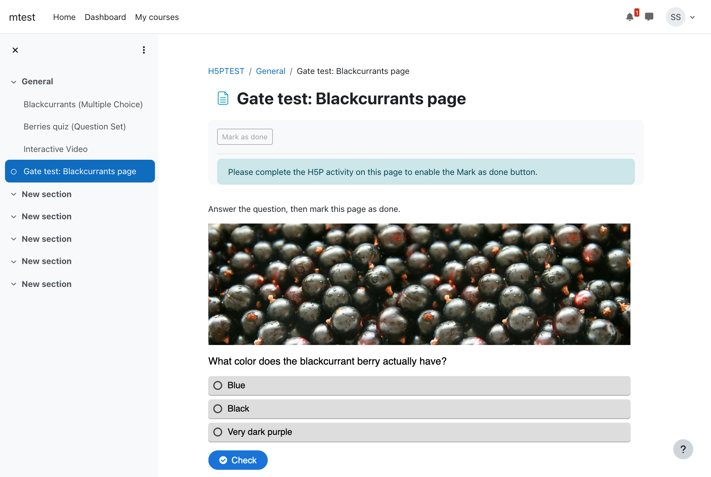

# Mark Complete Gate for H5P (Moodle)

Learners can click **Mark as done** on a Moodle activity without even trying the H5P on its page. This plugin keeps
the button locked until every H5P on the page is completed, and passed when it's scored.

Free and open source (GPL v3). The Moodle sister of [Mark Complete Gate for LearnDash](https://aikellogg.com/#/mark-complete-gate).

## What it does

On any activity that uses **manual completion** (Students can manually mark the activity as completed), when its page
has H5P (a Page or Book with embedded H5P, an H5P activity, and so on):

* the **Mark as done** button is locked, with a message under it;
* a **scored** H5P counts once the learner **passes** it. A wrong answer keeps it locked, and the learner can retry;
* with **several** H5P on the page, all of them must be done, and the message shows how many are;
* what a learner has passed is **remembered** on that browser, so a reload doesn't lock it again;
* pages without H5P, and activities with other completion settings, are left alone.

Moodle's own completion rules already cover graded H5P activities ("Receive a passing grade"). This plugin covers the
gap: H5P **embedded** in a Page, Book or other activity, which records no grade.

## Who is gated

Learners. Anyone with **local/markcompletegate:bypass** (editing teachers, teachers and managers by default) is never
gated.

## Settings

**Site administration → Plugins → Local plugins → Mark Complete Gate for H5P**

* **Gate the Mark as done button**: on or off for the whole site.
* **Content types that don't count**: H5P types that are only for reading or watching and never report completion
  (Accordion, Image, Video and similar). One machine name per line.

## Install

1. Install the zip in **Site administration → Plugins → Install plugins** (or copy this folder to
   `local/markcompletegate`; `public/local/markcompletegate` in Moodle 5.1+).
2. Visit **Site administration → Notifications** to finish.

Uses Moodle's built-in H5P. Requires Moodle 4.1 or later. Tested on Moodle 4.5.16 (LTS) with PHP 8.2 and MySQL 8.4.
It has no database tables of its own.

## Good to know

The lock is in the learner's browser. It keeps honest learners on track, but someone determined can get around it with
the browser's developer tools.

## Privacy

It stores nothing on the server and sends nothing anywhere. To remember which H5P a learner has passed on a page, it
keeps a small note in that learner's own browser (local storage).

## Support

Report bugs and ask for features in the [issue tracker](https://github.com/pfkellogg/moodle-local_markcompletegate/issues).

## Licence

GNU GPL v3 or later (see `LICENSE`).

---

H5P is a registered trademark of H5P Group. This plugin is independent: it is not made or endorsed by H5P Group.
Made by Patrick Kellogg.
